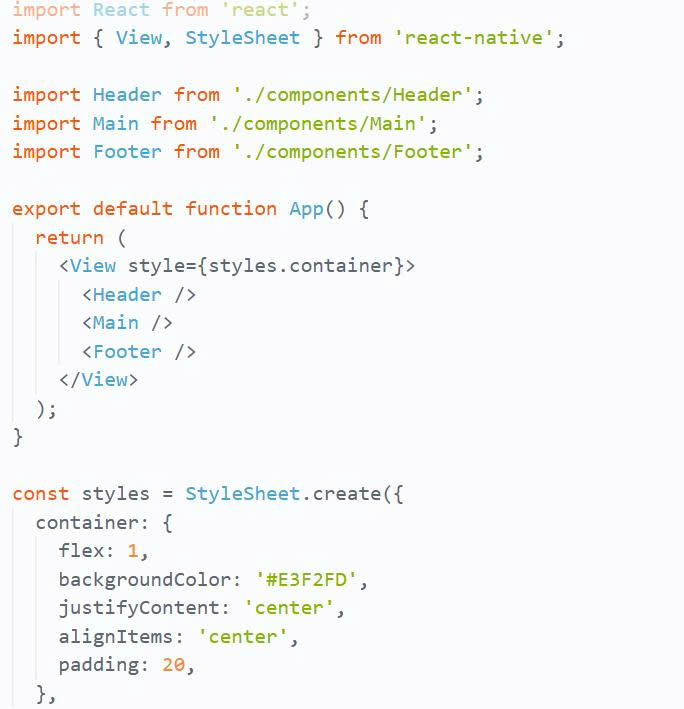
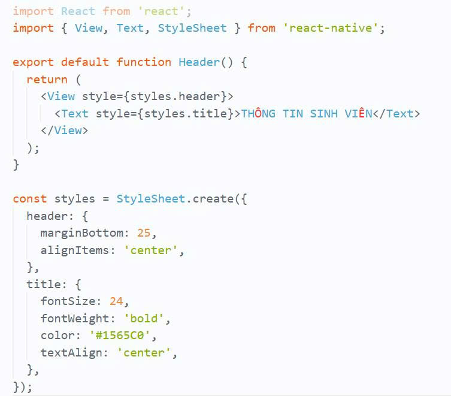
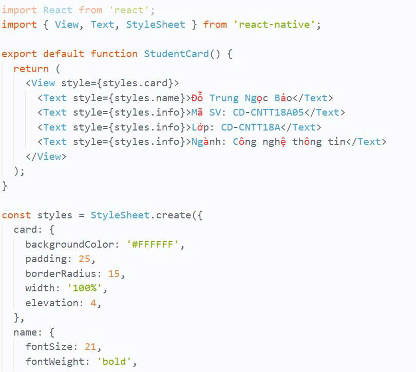
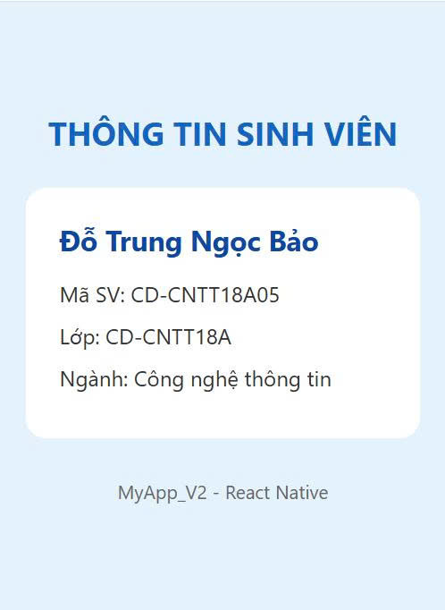

# BÀI 02 – BT01: THIẾT KẾ GIAO DIỆN REACT NATIVE

## 1. Thông tin sinh viên

- Họ tên: Đỗ Trung Ngọc Bảo
- Mã sinh viên: CD-CNTT18A05
- Lớp: CD-CNTT18A
- Tên ứng dụng: MyApp_V2 DoTrungNgocBao

## 2. Link ứng dụng Expo

[MyApp_V2 trên Expo Snack](https://snack.expo.dev/@dotrungngocbao/myapp_v2-dotrungngocbao)

## 3. Ý tưởng ứng dụng

Xây dựng ứng dụng Thông tin sinh viên bằng React Native trên Expo Snack.

Ứng dụng hiển thị họ tên, mã sinh viên, lớp và ngành học, với giao diện đơn giản và dễ sử dụng.

## 4. Các component

- **App.js:** Component gốc, kết nối các component.
- **Header.js:** Hiển thị tiêu đề.
- **Main.js:** Chứa nội dung chính.
- **StudentCard.js:** Hiển thị thông tin sinh viên.
- **Footer.js:** Hiển thị tên ứng dụng.

## 5. Thay đổi giao diện

- Đổi màu nền thành xanh nhạt bằng `backgroundColor`.
- Thay đổi kích thước chữ bằng `fontSize`.
- Làm đậm tiêu đề bằng `fontWeight`.
- Bo góc thẻ thông tin bằng `borderRadius`.
- Điều chỉnh khoảng cách bằng `padding` và `marginBottom`.
- Sắp xếp giao diện bằng `justifyContent` và `alignItems`.

## 6. Mã nguồn App.js

```jsx
import React from 'react';
import { View, StyleSheet } from 'react-native';

import Header from './components/Header';
import Main from './components/Main';
import Footer from './components/Footer';

export default function App() {
  return (
    <View style={styles.container}>
      <Header />
      <Main />
      <Footer />
    </View>
  );
}

const styles = StyleSheet.create({
  container: {
    flex: 1,
    backgroundColor: '#E3F2FD',
    justifyContent: 'center',
    alignItems: 'center',
    padding: 20,
  },
});
```

## 7. Hình ảnh minh chứng

### Code App.js



### Code Header.js



### Code StudentCard.js



### Cấu trúc component


### Giao diện ứng dụng



## 8. Kết quả

Ứng dụng MyApp_V2 đã chạy thành công trên Expo Snack, sử dụng các component riêng biệt và hiển thị giao diện thông tin sinh viên.
