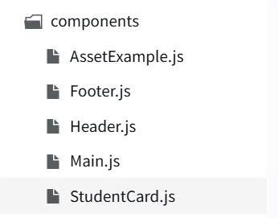

# BÀI 02 – BT01: ỨNG DỤNG BÁN BÁNH MÌ

## 1. Thông tin sinh viên

- Họ tên: Đỗ Trung Ngọc Bảo
- Mã sinh viên: CD-CNTT18A05
- Lớp: CD-CNTT18A
- Môn học: React Native
- Tên ứng dụng: MyApp_V2_BanhMiNgocBao

## 2. Link ứng dụng Expo Snack

[**Xem ứng dụng BÁNH MÌ NGỌC BẢO trên Expo Snack**](https://snack.expo.dev/@dotrungngocbao/myapp_v2_banhmingocbao)

## 3. Giới thiệu ứng dụng

Ứng dụng BÁNH MÌ NGỌC BẢO được xây dựng bằng React Native trên nền tảng Expo Snack.

Ứng dụng mô phỏng cửa hàng bán bánh mì với giao diện hiện đại, màu cam kết hợp đen và trắng.

## 4. Các chức năng chính

1. Hiển thị danh sách 6 loại bánh mì.
2. Tìm kiếm bánh mì theo tên.
3. Thêm sản phẩm vào giỏ hàng.
4. Tăng và giảm số lượng sản phẩm.
5. Tự động tính tổng tiền.
6. Xác nhận đặt hàng mô phỏng.
7. Chuyển đổi giữa trang chủ và giỏ hàng.

## 5. Cấu trúc component

```text
MyApp_V2_BanhMiNgocBao/
├── App.js
└── components/
    ├── Header.js
    ├── Home.js
    ├── ProductCard.js
    ├── ProductList.js
    ├── Cart.js
    └── Footer.js
```

## 6. Mô tả mã nguồn

### App.js
- Sử dụng `useState` để quản lý trạng thái.
- Quản lý danh sách sản phẩm và giỏ hàng.
- Kết nối các component.
- Xử lý thêm sản phẩm, tăng giảm số lượng và xác nhận đơn hàng.

### Header.js
- Hiển thị tên cửa hàng.
- Sử dụng `View`, `Text` và `StyleSheet`.
- Thiết kế nền tối, chữ màu cam.

### Home.js
- Hiển thị banner khuyến mãi.
- Kết nối component `ProductList`.

### ProductCard.js
- Hiển thị tên, biểu tượng và giá sản phẩm.
- Sử dụng `TouchableOpacity` để thêm sản phẩm vào giỏ hàng.

### ProductList.js
- Hiển thị danh sách bánh mì.
- Sử dụng `TextInput` để tìm kiếm.
- Lọc sản phẩm bằng hàm `filter()`.

### Cart.js
- Hiển thị sản phẩm trong giỏ hàng.
- Tăng, giảm số lượng.
- Tính tổng tiền và xác nhận đặt hàng.

### Footer.js
- Hiển thị thanh điều hướng.
- Chuyển đổi giữa trang chủ và giỏ hàng.

## 7. Các thay đổi giao diện

- `backgroundColor`: Thay đổi màu nền.
- `fontSize`: Điều chỉnh kích thước chữ.
- `fontWeight`: Làm đậm tiêu đề.
- `borderRadius`: Bo tròn các thẻ sản phẩm.
- `padding`: Tạo khoảng cách bên trong.
- `marginBottom`: Tạo khoảng cách giữa các thành phần.
- `flexDirection`: Sắp xếp nội dung theo hàng ngang.
- `justifyContent`: Căn chỉnh các thành phần.

## 8. Hình ảnh minh chứng

### Hình 1: Giao diện trang chủ


### Hình 2: Chức năng tìm kiếm


### Hình 3: Giỏ hàng và tổng tiền


### Hình 4: Cấu trúc component


### Hình 5: Mã nguồn React Native


## 9. Kết quả

Ứng dụng BÁNH MÌ NGỌC BẢO đã được xây dựng bằng React Native trên Expo Snack.

Ứng dụng sử dụng các component riêng biệt, có giao diện bán hàng và hỗ trợ các chức năng quản lý giỏ hàng cơ bản.

**Sinh viên thực hiện: Đỗ Trung Ngọc Bảo – CD-CNTT18A05**
